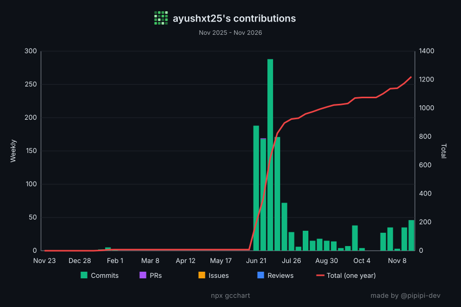

## Welcome to Ayush's Github

# About Me:

I work primarily on backend systems, with a particular interest in what happens beyond the API layer: task execution, concurrency, failure recovery, data consistency, and observability.

My projects span durable workflow engines, distributed task processing, AI agent orchestration, and retrieval systems. I mainly work with Python, Java, TypeScript, PostgreSQL, Redis, and Docker.

## Connect with me 

&nbsp;&nbsp;
&nbsp;&nbsp;
&nbsp;&nbsp;
&nbsp;&nbsp;

# Tech Stack

### Languages

### Frontend

### Backend & APIs

### Databases & Caching

### AI/ML & Data

### Tools & Platforms

# 📊 GitHub Stats:

## 📈 Contribution Activity

---

